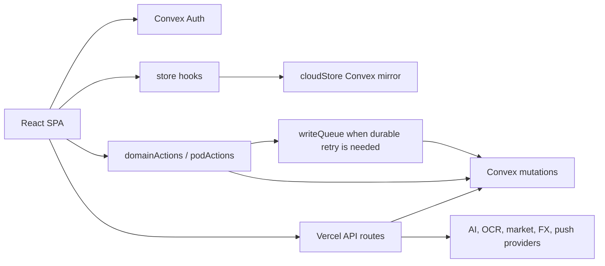

# Architecture

## High-level shape

Numa Pro is a Vite React SPA backed by Convex and deployed through Vercel. Convex
Auth is required for runtime use. Vercel functions handle provider-facing API
work. Client state mirrors Convex data and routes writes through typed actions
or a durable retry queue.

## Main directories

- `src/routes/`: page-level route modules.
- `src/components/ui/`: primitives such as Button, Card, Dialog, Avatar.
- `src/components/layout/`: shell, sidebar, top bar, bottom nav, FAB, search.
- `src/components/features/`: domain dialogs and flows.
- `src/components/charts/`: local SVG charts using `src/lib/chartMath.ts`.
- `src/services/`: auth, store, Convex mirror, typed actions, write queue,
  market/FX/push/scan services.
- `src/lib/`: pure helpers, types, money, analytics, ledger, i18n, theme.
- `src/styles/`: global CSS and design tokens.
- `convex/`: backend schema, queries, mutations, auth, access, receipts.
- `api/`: Vercel functions.
- `tests/`: Playwright browser tests.
- `ios/Numa/`: native Numa Pro SwiftUI client; see its README for target pairing.

## Routes and gates

- Public/pre-auth: `/welcome`, `/landing`, `/terms`, `/privacy`.
- Legacy auth redirects: `/login`, `/signup` -> `/welcome`.
- Authenticated shell: `/`, `/money`, `/buckets`, `/wealth`, `/goals`,
  `/insights`, `/numa`, `/shared`, `/pod`, `/settings`.
- First-run onboarding: `/onboarding/mode` -> `/onboarding/setup` -> Home.
  `/onboarding/style` is a compatibility redirect; `/onboarding/ready` persists
  completion without a timed presentation screen.
- Shared mode renders the pod at `/` and blocks personal surfaces.
- Light mode blocks advanced wealth/shared routes.

## Data flow

- `src/services/auth.tsx` creates the Convex client only when cloud auth env is
  configured.
- `CloudDataProvider` mirrors Convex queries into client-visible state.
- `StoreProvider` exposes read hooks and local compatibility state.
- Product writes use `domainActions.ts`, `podActions.ts`, or
  `writeQueue.tsx`.
- Convex mutations enforce access through helpers in `convex/lib/access.ts`.
- Replayable mutations should use `clientMutationId` receipts.

## Storage model

- Convex tables are the product database.
- `localStorage` is allowed for UI prefs, onboarding markers, chat history,
  geocode/FX/quote caches, and the write queue.
- `convex/_generated/` is tracked but generated.
- Ledger tables exist, but many UI rollups still read legacy finance tables.
  `src/lib/ledger.ts` has focused tests and remains a domain foundation even
  though the web entrypoint does not currently import it.

## API boundaries

- `api/chat.ts`: AI Gateway streaming assistant.
- `api/parse-receipt.ts`: receipt/voice parsing.
- `api/market-quotes.ts`: market quote fanout.
- `api/fx-rates.ts`: FX proxy/cache boundary.
- `api/push-send.ts`: internal web-push fanout.
- `api/webhooks/transaction.ts`: token-auth external transaction ingest.
- Expensive or sensitive work should happen only after auth/token/rate checks.

## Auth and security

- Convex Auth is mandatory for product runtime.
- Owners manage structure; editors create/update/delete finance and pod
  activity; viewers read.
- Pod members can update their own card metadata only where the server allows.
- AI actions are draft-first and audited.
- Current release boundaries are in [the rebuild release guide](../rebuild/RELEASE.md).
  Task authorization and private operating guidance do not live in this public repo.

## External state

Source describes behavior, not current deployment or device status. Consult
`docs/NUMA-PRO-PUBLIC-RELEASE.md` for release gates and verify the relevant
live target when a task depends on it.
