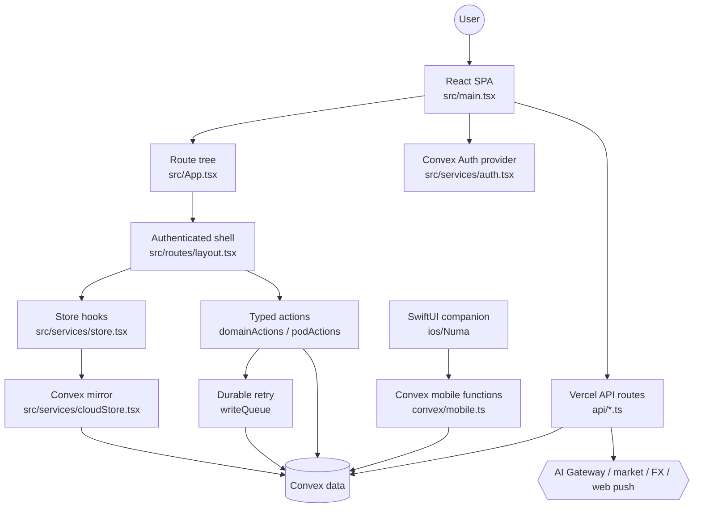
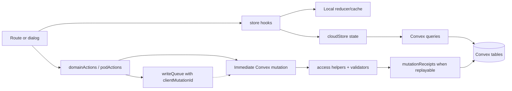

# Architecture

Numa is a Vite React single-page app with Convex as the product database and auth provider. The browser app boots with theme/mode applied before React, then `App.tsx` composes auth, cloud data mirroring, the local store, write queue, onboarding gates, route gates, and lazy route surfaces.

Convex owns product data: users/profiles, portfolios, transactions, assets, liabilities, holdings, goals, money pods, pod members/groups/expenses/settlements, ledger tables, mutation receipts, AI action drafts, push subscriptions, webhook tokens, merchant image cache, and rate-limit buckets. Vercel functions sit at provider/cost boundaries and must validate auth or token, rate-limit, and parse input before calling external providers.

The iOS companion is a SwiftUI app under `ios/Numa`; it talks to Convex through `convex/mobile.ts` and uses its own native session store. Its README still references Clerk setup, but current Swift code also contains Convex Auth password/OAuth token handling, so iOS auth status should be verified before native implementation work.

## System Diagram

## Data Flow

## Components

- **Browser boot** - [`src/main.tsx`](../../src/main.tsx) installs error/asset recovery, captures install prompt state, activates font CSS, applies theme and app mode, then mounts `AuthProvider` and `RouterProvider`.
- **Routing and gates** - [`src/App.tsx`](../../src/App.tsx) defines public routes, onboarding routes, protected app routes, `RequireAdvanced`, `RequirePersonal`, shared-mode home routing, and lazy-route asset recovery.
- **Shell** - [`src/routes/layout.tsx`](../../src/routes/layout.tsx) owns navigation, banners, global add/search/scan/import/tour affordances, and route-surface motion.
- **Client state** - [`src/services/store.tsx`](../../src/services/store.tsx) exposes hooks and compatibility reducer state; [`src/services/cloudStore.tsx`](../../src/services/cloudStore.tsx) controls Convex list/detail queries and mutation handles.
- **Write actions** - [`src/services/domainActions.ts`](../../src/services/domainActions.ts), [`src/services/podActions.ts`](../../src/services/podActions.ts), and [`src/services/writeQueue.tsx`](../../src/services/writeQueue.tsx) preserve typed, queued, idempotent write behavior.
- **Convex backend** - [`convex/schema.ts`](../../convex/schema.ts), [`convex/lib/access.ts`](../../convex/lib/access.ts), and [`convex/lib/mutationReceipts.ts`](../../convex/lib/mutationReceipts.ts) are the central data/auth/idempotency rules.
- **Edge/API** - [`api/_utils/auth.ts`](../../api/_utils/auth.ts), [`api/_utils/rate-limit.ts`](../../api/_utils/rate-limit.ts), and route handlers under `api/` guard paid/provider work.

## Key Design Decisions

- Convex Auth is required at runtime; there is no product local-auth fallback.
- Product writes should not bypass typed action layers.
- New replayable mutations need `clientMutationId` and receipt handling.
- Shared-mode `/pod` is joint expenses only and must stay mobile-first.
- AI writes are drafts first and require explicit user confirmation.
- `localStorage` is allowed for UI prefs, thread history, caches, onboarding markers, and queue state, not product cloud storage.
- Convex generated files are tracked but generated; regenerate, do not hand-edit.

## Documentation Drift Found

- [`README.md`](../../README.md) says charts are hand-rolled SVG; package dependencies confirm no Recharts dependency, and chart files are local (`src/components/charts`, `src/lib/chartMath.ts`). This appears current.
- The internal agent guide mentioned Recharts wrappers; that appears stale relative to `package.json`.
- [`ios/Numa/README.md`](../../ios/Numa/README.md) still describes Clerk as the native auth route; current [`NumaAuth.swift`](../../ios/Numa/Numa/NumaAuth.swift) + [`NumaSessionStore.swift`](../../ios/Numa/Numa/NumaSessionStore.swift) hold the Convex Auth password/OAuth token flow and Keychain persistence. Verify before iOS auth work.
