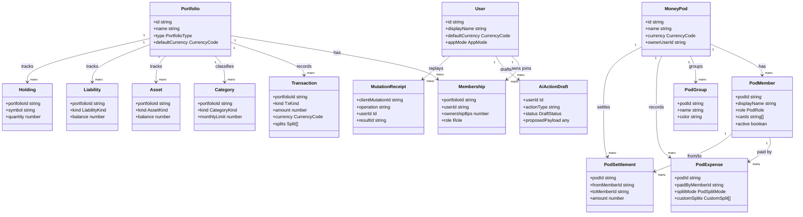

# Class Diagram

Numa is TypeScript-heavy, so this diagram models the central domain interfaces from [`src/lib/types.ts`](../../../src/lib/types.ts) and the main persistence/audit concepts in [`convex/schema.ts`](../../../convex/schema.ts).

## Notes

- `CurrencyCode` is wider on the client, but Convex currently narrows mutable currency fields to `USD | EUR`.
- `10000` basis points means 100 percent for ownership and custom splits.
- Pod member removal is tombstoned, not hard-deleted, so historical settlement math remains correct.
