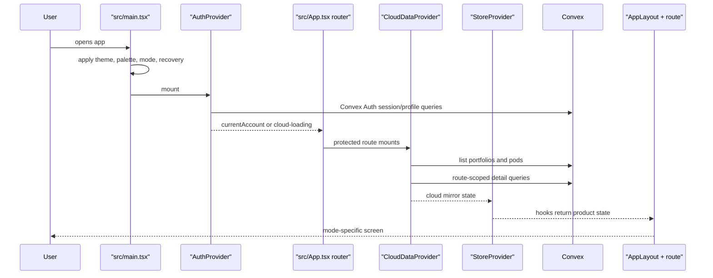
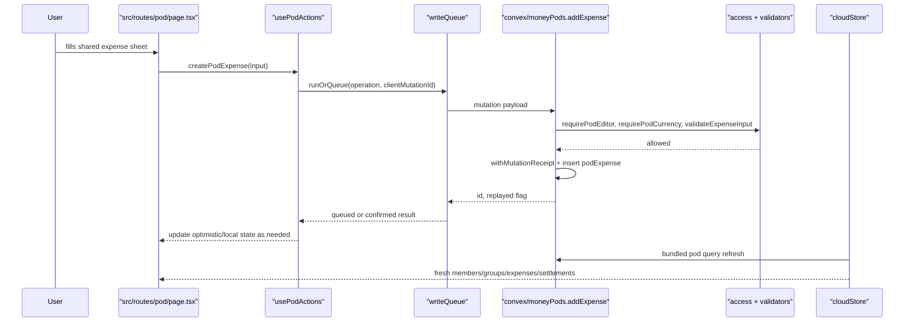
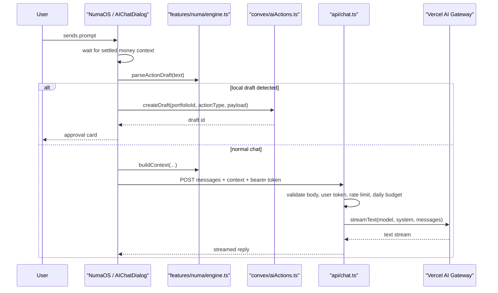
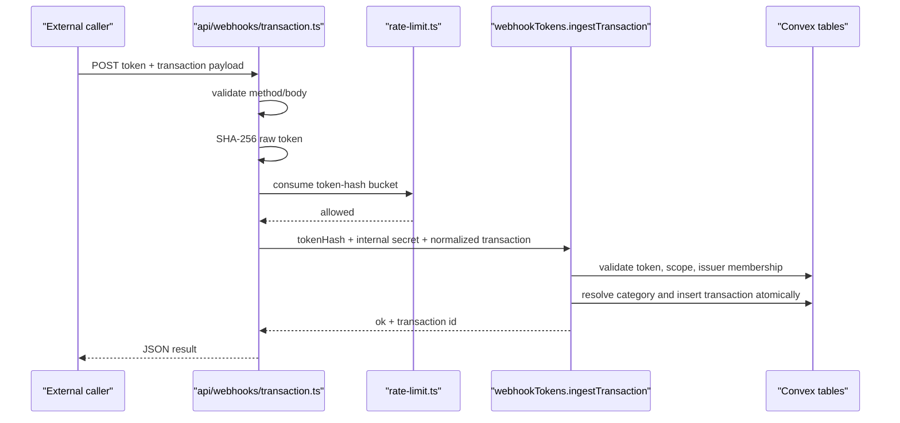

# Sequence Diagrams

## Workflow: Authenticated App Boot

The browser applies local visual state before React, then enters Convex Auth, route gates, cloud mirroring, store hooks, and the authenticated layout.

## Workflow: Shared Pod Expense Create

The `/pod` UI uses typed pod actions and the durable queue. Convex validates role, pod currency, member/group references, split totals, and mutation receipts before the cloud mirror refreshes.

## Workflow: Numa AI Draft Or Chat

`/numa` and the quick chat dialog first try local deterministic draft parsing. If no draft is found, they call `/api/chat`, which requires a signed-in Convex user and rate-limit budget before AI Gateway streaming.

## Workflow: External Transaction Webhook

The webhook route never exposes `transactions.add` directly. It hashes the raw token, then Convex validates scope and membership before atomically inserting the transaction.

